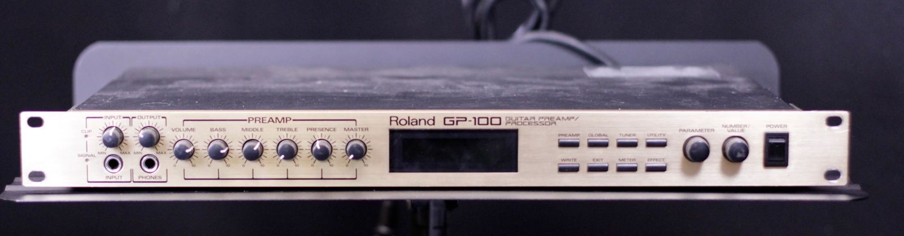

I recently acquired a classic, Roland GP-100 guitar effects processor from a friend. He is a wicked guitarist, multi-instrumentalist virtuoso, and owned it for decades. Naturally it's loaded with custom Jimmy Page and Zappa patches, EVH, ZZ Top, etc!

---

I recorded a dump of the GP memory onto an external MIDI track in Logic Pro. [And this](https://drive.google.com/file/d/1P_XY7moAdn7v3fV3Pe4dd_V0BWqTB19e/view?usp=drive_link) is MIDI sysex file of the patches. It's untested, because I've never tried it before, and I only have one GP-100!

## Here's what Google has to say on the matter:

To perform a System Exclusive (SysEx) memory dump (backup) or bulk load (restore) on your Roland GP-100, you will use the unit's [UTILITY] menu functions.

* MIDI OUT of the GP-100 connects to the MIDI IN of your computer interface.
* MIDI IN of the GP-100 connects to the MIDI OUT of your computer interface.

### Step-by-Step SysEx Bulk Dump (Backup)

   1. Open a SysEx utility program on your computer (such as MIDI-OX for Windows or SysEx Librarian for macOS) and set it to "Receive Manual Dump" or "Record".
   2. Press the [UTILITY] button on the front panel of the GP-100.
   3. Rotate the [PARAMETER] knob until "MIDI Bulk Dump" appears.
   4. Use the [VALUE] knob to specify the block or range of data you wish to backup.
   5. Press the [WRITE] button to begin sending the memory data.
   6. Save the captured data as a `.mid` or `.syx` file on your computer.

### Step-by-Step SysEx Bulk Load (Restore)

   1. Press the [UTILITY] button.
   2. Rotate the [PARAMETER] knob until "MIDI Bulk Load" is displayed on the screen. The unit will enter a standby state to wait for incoming MIDI streams.
   3. Transmit from Computer: Open your saved file in your SysEx utility software and send or transmit.
   4. The GP-100 screen will display data packet reception status. Once the file transmission from the software stops, the unit automatically processes and overwrites the designated user memory spots.
   5. Press [EXIT] to return to the normal Play screen.

## Anyway...

If **you** have it dialed-in, please [check it out](https://drive.google.com/file/d/1P_XY7moAdn7v3fV3Pe4dd_V0BWqTB19e/view?usp=drive_link) and see if it works for you.

Here are the patch types and names that I tediously compiled by hand:

```
      Type      Name    
  1    vintage    Blue top loose    
  2    basic      SLDN super lead    
  3    harmony    Reversed 2    
  4    dual       Van Halen brown    
  5    dual       Van Halen brown    
  6    vintage    Zappa wah wah    
  7    vintage    Les-wired2    
  8    vintage    Hadden=ed    
  9    basic      Blow by blow dry    
 10    basic      No.1 combo    
 11    delay      Zeppelin phase    
 12    basic      Heartbeat:Belew    
 13    basic      Heartbeat:Belew    
 14    delay      Good times bad..    
 15    vintage    Tremolo Page    
 16    vintage    Terry Kath= lead    
 17    vintage    Jimmy Page trans    
 18    vintage    Jimmy Page slap    
 19    harmony    Reversed 2    
 20    vintage    Zappa wah wah    
 21    vintage    Comp'd Marshall    
 22    vintage    Strat Marshall    
 23    vintage    Pork pie hat    
 24    vintage    Strat med gain    
 25    dual       Van Halen 5150 II    
 26    vintage    Strat med gain    
 27    vintage    Clean top    
 28    vintage    Hi gain Marshall    
 29    basic      Full blown drive    
 30    basic      Eric Johnson cln    
 31    vintage    Eric Johnson OD2    
 32    basic      Clear cut echo    
 33    basic      Eric Johnson cl+    
 34    vintage    Eric Johnson OD1    
 35    dual       Super Butcher    
 36    delay      Eric high phase    
 37    harmony    Reversed 2    
 38    harmony    One Time    
 39    vintage    Sweet 1959 lead    
 40    basic      Heartbeat:Belew    
 41    vintage    Les-wired1    
 42    vintage    Townshend Paul 1    
 43    vintage    Blues top boost    
 44    vintage    Blues top boost    
 45    vintage    Cant u hear me?    
 46    vintage    Strat Marshall    
 47    vintage    Blues top boost    
 48    vintage    Blues top boost    
 49    vintage    Joe's 1959 lead    
 50    vintage    Cant u hear me?    
 51    delay      Eric high phase    
 52    vintage    Blues top boost    
 53    vintage    Jimmy Page= live    
 54    vintage    Wah wah two    
 55    vintage    Cant u hear me?    
 56    vintage    Only rock n roll    
 57    vintage    Rolling Stones    
 58    vintage    Blues top boost    
 59    vintage    Blues top boost    
 60    basic      Chors cut echo    
 61    vintage    Start me up    
 62    vintage    Live at Leeds 1    
 63    vintage    Lead tube amp ==-    
 64    vintage    Wah wah two    
 65    delay      Modulated phase    
 66    delay      Modulated phase    
 67    vintage    Townshend Paul 1    
 68    vintage    Duane tremolo    
 69    vintage    Small amp    
 70    vintage    Les-clean¥    
 71    vintage    Les-blues¥    
 72    vintage    Les-wired1    
 73    vintage    Les-wired2    
 74    vintage    Wah wah two    
 75    basic      Heartbeat:Belew    
 76    vintage    Les-wired2    
 77    basic      Blow by blow dry    
 78    vintage    Les-wired2    
 79    vintage    Hadden=ed2    
 80    dual       Van Halen brown    
 81    vintage    Jimmy Page vox    
 82    vintage    Joe's 1959 lead
 83    dual       Van Halen brown    
 84    vintage    Jimmy Page vox    
 85    basic      Heartbeat:Belew    
 86    dual       Too Rollinstoned    
 87    basic      Robin Trower 1    
 88    vintage    Black Crowes=    
 89    delay      Fripp echo    
 90    delay      Montana lead    
 91    vintage    Townshend Paul 1    
 92    dual       Too Rollinstoned    
 93    delay      Lark's tongues II    
 94    vintage    Lead tube amp ==-    
 95    vintage    Jag-wired1    
 96    dual       Super Butcher    
 97    basic      Cutting comp    
 98    vintage    Blues top boost    
 99    basic      Blues combo    
100    dual       Super sizzler    
101    basic      Bright twin    
102    vintage    Mild jazz    
103    delay      Halen big bottom    
104    vintage    Blues top boost    
105    delay      70s fusion OD-1    
106    basic      Turbo cry baby    
107    harmony    Major chord    
108    delay      Phasing chorus    
109    vintage    Slow gear SG-1    
110    delay      Heavy drive    
111    delay      Brian echo    
112    basic      Mellow comp    
113    basic      Fat MS stack    
114    basic      Rockin tweed #1    
115    delay      West coast    
116    delay      Wah phase    
117    basic      Octave down    
118    delay      Modulated phase    
119    basic      Metal 5150 lead    
120    basic      Metal 5150 lead    
121    delay      Turbo OD-2 lead    
122    basic      Cutting comp    
123    basic      Fat echo stack    
124    delay      JC-120 clean    
125    delay      60s back beat    
126    basic      Fuzz wah wah    
127    harmony    Sizzlin harmony    
128    delay      Flanging phase    
129    vintage    Vibrato VB-2    
130    basic      Turbo OD-2    
131    basic      Metallic dist    
132    basic      American twin    
133    delay      Fat super Satch    
134    basic      UK crunch-bright    
135    basic      Blues drive    
136    delay      Pedal phase 1    
137    harmony    Detuned octave    
138    delay      Clean phase    
139    vintage    Panning    
140    delay      Fuzz lead    
141    delay      Rock woman drive    
142    delay      Orange comp    
143    vintage    Mild fuzz lead    
144    basic      JC-120 daydream    
145    delay      Venture lead    
146    delay      Mild wah twin    
147    delay      Pedal 2fret down    
148    delay      Hi band flanger    
149    vintage    Auto wah    
150    basic      Woman tone    
151    delay      Metal backing    
152    delay      Ducking delay    
153    delay      Punk stack    
154    delay      Whacky pluck    
155    basic      Blues combo    
156    vintage    Pedal VCF reso    
157    harmony    Diminished pan    
158    delay      Flange drive    
159    vintage    Pedal feedbacker    
160    delay      Stereo echo    
161    basic      Fat BG drive
162    delay      Analog delay    
163    delay      Tempo drive    
164    vintage    Rhythm master    
165    basic      Crunch SLDN    
166    delay      Flanging wah    
167    harmony    Gouitar soundtrack    
168    vintage    Growling pan    
169    vintage    Tremelo wah    
170    delay      Presence lead    
171    delay      Sweet turbo OD    
172    basic      Jazz tone    
173    delay      BG power stack
174    delay      Acousticrisp    
175    delay      Detuned drive    
176    delay      JC clear pedal wah    
177    delay      Twin lead in C    
178    vintage    Vibrato wah    
179    vintage    Metal vibro wah    
180    basic      Sweet distortion    
181    delay      No Quarter fuzz    
182    vintage    Mild sustain    
183    delay      Metal distortion    
184    delay      Echoplex twin    
185    basic      MS 1959 crunch    
186    delay      Pedal phase 2    
187    harmony    Reversed octave    
188    delay      Phasing echo    
189    vintage    Metal vibro pan    
190    basic      Grange dist    
191    vintage    Sweet 1969 lead    
192    vintage    Mellow tone    
193    delay      Bridge of sighs    
194    delay      Tap delay twin    
195    delay      JC-120 drive    
196    delay      Comp wah drive    
197    harmony    4th pitch shift    
198    vintage    Crying pan    
199    harmony    Synth bass    
200    dual       Two Geddy overdr    
```

Btw, here is a cool [write-up](https://www.vintagedigital.com.au/roland-gp-100/) on the device. And here are its [technical specifications](https://support.roland.com/hc/en-us/articles/201946959-GP-100-Technical-Specifications).

`#Roland #GP100 #MIDI #SYSEX`
